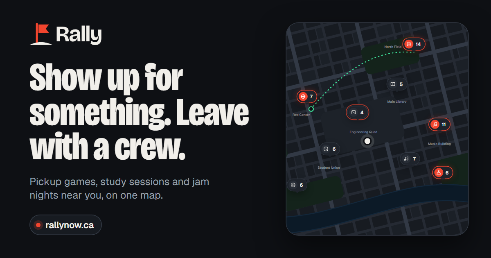
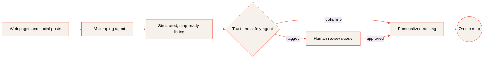
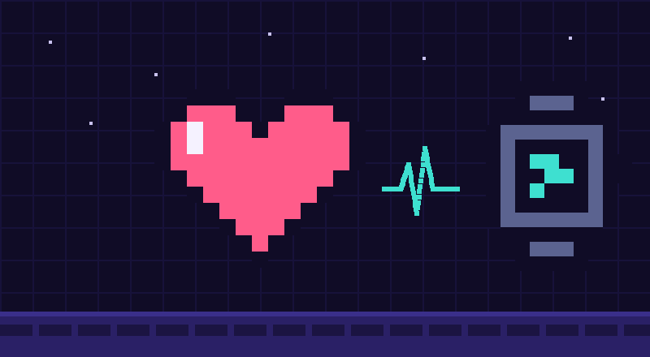
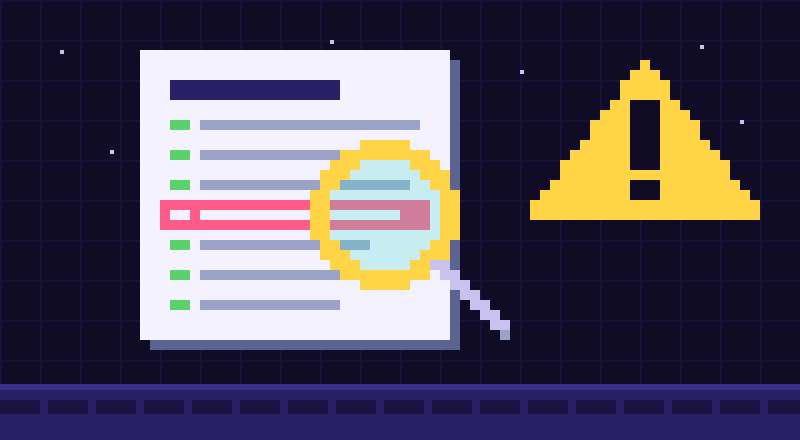
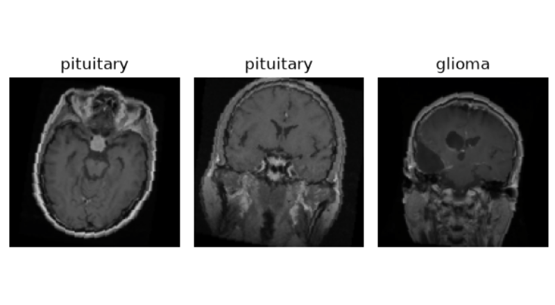
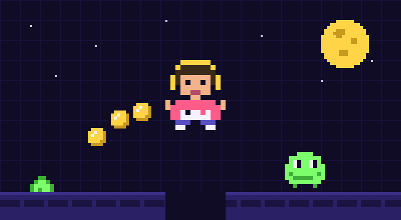
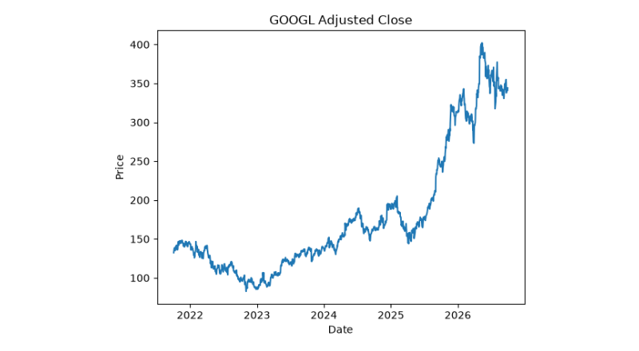
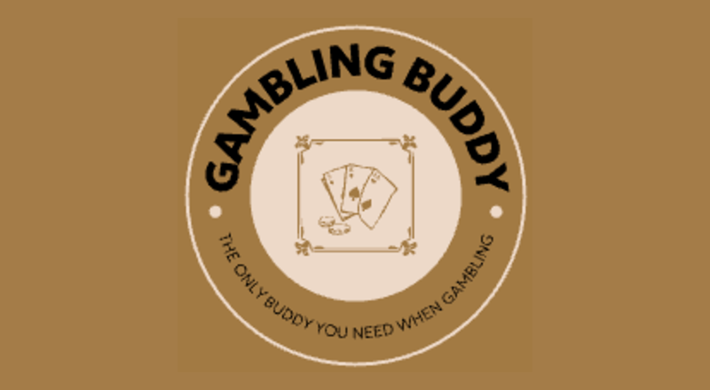

  

  

  

  
  
  

 

<table align="center">
  <tr>
    <td width="60%" valign="top">
      <h3>Hey, I'm Matin 👋</h3>
      

        I study Computer Science at the <b>University of Ottawa</b> with a concentration in <b>AI &amp; ML</b>.
        Right now I split my time between robotics research at <b>Adaptron</b>, a greenhouse robot that picks ripe
        crops, and <b>Rally</b>, the app I'm co-founding.
      

      <table>
        <tr><td>🤖 <b>Now</b></td><td>AI Research &amp; Robotics Engineer at Adaptron (co-op)</td></tr>
        <tr><td>🌱 <b>Also</b></td><td>AI/ML Engineer (freelance) on CropPilot, greenhouse automation</td></tr>
        <tr><td>🚩 <b>Building</b></td><td>Rally, as a co-founder</td></tr>
        <tr><td>🧠 <b>Capstone</b></td><td>A mental-health assistant that uses RAG and wearable data</td></tr>
        <tr><td>🏛️ <b>Before</b></td><td>Health Canada, data science &amp; analytics (two co-op terms)</td></tr>
      </table>
      

        🕹️ <a href="https://matinmobini.com"><b>matinmobini.com</b></a> &nbsp;·&nbsp;
        💼 <a href="https://www.linkedin.com/in/matin-mobini-56aa56277/"><b>LinkedIn</b></a> &nbsp;·&nbsp;
        ✉️ <a href="mailto:hmobinimatin@gmail.com"><b>Email</b></a>
      

    </td>
    <td width="40%" align="center" valign="middle">
      
    </td>
  </tr>
</table>

<h3 align="center">🕹️ My portfolio is a game</h3>

  

  A small neural network I trained with neuroevolution plays through my portfolio while you scroll. 
  Open its brain to see it think, watch a population learn live in the Training Lab, or take the controls yourself.

  
  

<h3 align="center">🚩 What I'm building: Rally</h3>

<table align="center">
  <tr>
    <td width="50%" valign="middle">
      
    </td>
    <td width="50%" valign="top">
      
<b>Co-founder</b> · Sep 2026 to now

      
Rally puts the pickup games, study sessions and jam nights around you on one map, so meeting people starts with showing up.

      
<b>What I work on</b>

      <ul>
        <li>The iOS and Android app (Kotlin Multiplatform, Supabase) and its personalized event ranking</li>
        <li>An LLM scraping agent that finds events across the web and social platforms and turns them into map-ready listings. It surfaced 200+ events in testing.</li>
        <li>A trust-and-safety agent that screens events and users and sends anything flagged to a human review queue</li>
      </ul>
    </td>
  </tr>
</table>

  
  
  
  

  
<b>How an event gets onto the map</b> (click to open)

   

<h3 align="center">💼 Experience</h3>

<table align="center">
  <tr><th align="left" width="15%">Where</th><th align="left" width="23%">Role</th><th align="left" width="17%">When</th><th align="left">Highlights</th></tr>
  <tr>
    <td><b>Adaptron Inc.</b> Ottawa</td>
    <td>AI Research &amp; Robotics Engineer Co-op</td>
    <td>May to Dec 2026</td>
    <td>Core modules of a developmental cognitive AI agent in Python (long-term memory, perception, pattern recognition, action selection), a closed-loop sense-think-act pipeline in robot simulation, and an experimentation harness with ablations and regression suites</td>
  </tr>
  <tr>
    <td><b>CropPilot</b> Ottawa</td>
    <td>AI/ML Engineer Freelance</td>
    <td>Jul 2026 to now</td>
    <td>Robotic-arm system for an agri-tech partner that detects crops, ripeness and plant disease with real-time computer vision (YOLO, PyTorch, OpenCV, RGB-D), plus a continuous-learning pipeline starting from a 0.76 mAP@0.5 baseline</td>
  </tr>
  <tr>
    <td><b>Health Canada</b> Ottawa</td>
    <td>Software Developer, Data Science &amp; Analytics Co-op</td>
    <td>May 2025 to Jan 2026</td>
    <td>A Case Management Tool adopted across government branches, with an on-premise LLM assistant that uses RAG over 100,000+ JSON case records</td>
  </tr>
  <tr>
    <td><b>Health Canada</b> Ottawa</td>
    <td>Junior Analyst, Data Science &amp; Analytics Co-op</td>
    <td>Jan to Apr 2025</td>
    <td>A cheminformatics tool that runs 881 substructure tests to build molecular fingerprints, and ChemPath, a synthesis-pathway mapping tool</td>
  </tr>
</table>

<h3 align="center">🧪 Projects</h3>

<table align="center">
  <tr>
    <td width="33%" valign="top">
      
       <b>Mental Health Assistant</b> · capstone
       RAG over clinical literature (92% hit@6) plus a stress classifier fed by heart-rate data from a smartwatch.
       
    </td>
    <td width="33%" valign="top">
      
       <b><a href="https://github.com/MatinHMobini/hallucination-detector">Hallucination Detector</a></b>
       Flags unfaithful sentences in news summaries and shows the article line that contradicts them.
    </td>
    <td width="33%" valign="top">
      
       <b><a href="https://github.com/MatinHMobini/brain-mri-cnn-pytorch">Brain MRI CNN</a></b>
       A from-scratch PyTorch CNN that sorts brain MRI scans into 4 classes, 85% test accuracy.
    </td>
  </tr>
  <tr>
    <td width="33%" valign="top">
      
       <b><a href="https://github.com/MatinHMobini/Portfolio">Pixel Quest</a></b> · this portfolio
       A neural net trained by neuroevolution plays every level of my site. TypeScript, Canvas, Web Workers.
    </td>
    <td width="33%" valign="top">
      
       <b><a href="https://github.com/MatinHMobini/googl-return-forecasting">GOOGL Return Forecasting</a></b>
       Next-day return forecasting with Ridge regression and a leakage-free long/flat backtest.
    </td>
    <td width="33%" valign="top">
      
       <b><a href="https://github.com/MatinHMobini/My-Gambling-Buddy">My Gambling Buddy</a></b> · uOttawaHack 8
       Sports stats across five leagues, explained by an AI buddy with personality.
    </td>
  </tr>
</table>

  
<b>More projects</b> (click to open)

   

| Project | What it is | Built with |
|---|---|---|
| [LLM Dinner Recipe Generator](https://github.com/MatinHMobini/llm-dinner-recipe-generator) | Turns a diet profile into one personal recipe with a single, layered prompt | Python, OpenAI API |
| [House Price Predictor](https://github.com/MatinHMobini/House-Price-Prediction) | Random Forest tuned with GridSearchCV (RMSE 50,414) on a Kaggle dataset | scikit-learn, pandas |
| [Cycling Club App](https://github.com/MatinHMobini/Cycling-Club-Event-Management-App) | Android app for cycling events and members, built by a team of 4 | Java, Android, Firebase |
| [Hotel Booking Service](https://github.com/MatinHMobini/CSI_2132_Databases_1) | SQL database and web app for searching and booking hotel rooms | PostgreSQL, React, TypeScript |

<h3 align="center">🛠️ Languages &amp; Tools</h3>

<table align="center">
  <tr>
    <td align="right"><b>Languages</b></td>
    <td>
      
       
    </td>
  </tr>
  <tr>
    <td align="right"><b>ML &amp; Deep Learning</b></td>
    <td>
      
       
      
      
      
      
      
      
      
    </td>
  </tr>
  <tr>
    <td align="right"><b>Generative AI</b></td>
    <td>
      
      
      
      
      
      
      
      
    </td>
  </tr>
  <tr>
    <td align="right"><b>Backend &amp; Data</b></td>
    <td>
      
       
    </td>
  </tr>
  <tr>
    <td align="right"><b>MLOps &amp; Cloud</b></td>
    <td>
      
       
      
      
    </td>
  </tr>
  <tr>
    <td align="right"><b>Editors</b></td>
    <td>
      
       
    </td>
  </tr>
</table>

<h3 align="center">🎓 Coursework</h3>

Honours BSc in Computer Science (Co-op), University of Ottawa · CGPA 8.94 / 10 · graduating April 2027

🏅 Admission Scholarship (2022) · Merit Scholarship (2023, 2024, 2025) · Montrusco Bolton Merit Scholarship (2026)

<table align="center">
  <tr>
    <td valign="top" width="50%">
      <table width="100%">
        <tr><th colspan="2" align="left">🤖 AI, ML &amp; Data</th></tr>
        <tr><td><code>SEG 4180</code> Applied Machine Learning</td><td align="right"><b>A+</b></td></tr>
        <tr><td><code>CSI 4142</code> Fundamentals of Data Science</td><td align="right"><b>A</b></td></tr>
        <tr><td><code>CSI 4107</code> Information Retrieval</td><td align="right"><b>A</b></td></tr>
      </table>
       
      <table width="100%">
        <tr><th colspan="2" align="left">📐 Math &amp; Statistics</th></tr>
        <tr><td><code>MAT 1322</code> Calculus II</td><td align="right"><b>A+</b></td></tr>
        <tr><td><code>MAT 1348</code> Discrete Math for Computing</td><td align="right"><b>A</b></td></tr>
        <tr><td><code>MAT 1341</code> Linear Algebra</td><td align="right"><b>A-</b></td></tr>
        <tr><td><code>MAT 1320</code> Calculus I</td><td align="right"><b>A-</b></td></tr>
        <tr><td><code>MAT 2377</code> Probability &amp; Statistics</td><td align="right"><b>B+</b></td></tr>
      </table>
       
      <table width="100%">
        <tr><th align="left">⏳ In progress</th></tr>
        <tr><td><code>CSI 4900</code> Honours Project</td></tr>
        <tr><td><code>CSI 4133</code> Picture Processing &amp; Analysis</td></tr>
        <tr><td><code>CSI 4141</code> Real-Time Systems Design</td></tr>
      </table>
    </td>
    <td valign="top" width="50%">
      <table width="100%">
        <tr><th colspan="2" align="left">💻 Core Computer Science</th></tr>
        <tr><td><code>CSI 2110</code> Data Structures &amp; Algorithms</td><td align="right"><b>A+</b></td></tr>
        <tr><td><code>CSI 3105</code> Design &amp; Analysis of Algorithms</td><td align="right"><b>A-</b></td></tr>
        <tr><td><code>CSI 2120</code> Programming Paradigms</td><td align="right"><b>A+</b></td></tr>
        <tr><td><code>CSI 3120</code> Programming Language Concepts</td><td align="right"><b>A+</b></td></tr>
        <tr><td><code>CSI 3104</code> Formal Languages</td><td align="right"><b>A+</b></td></tr>
        <tr><td><code>CSI 2372</code> Advanced Programming in C++</td><td align="right"><b>A+</b></td></tr>
        <tr><td><code>ITI 1121</code> Intro to Computing II (OOP)</td><td align="right"><b>A+</b></td></tr>
        <tr><td><code>CSI 2132</code> Databases I</td><td align="right"><b>A</b></td></tr>
        <tr><td><code>CEG 2136</code> Computer Architecture I</td><td align="right"><b>A</b></td></tr>
        <tr><td><code>CSI 2101</code> Discrete Structures</td><td align="right"><b>A</b></td></tr>
        <tr><td><code>SEG 2105</code> Software Engineering</td><td align="right"><b>A</b></td></tr>
        <tr><td><code>CSI 3140</code> Web Structures &amp; Standards</td><td align="right"><b>A</b></td></tr>
        <tr><td><code>CEG 3185</code> Data Communications &amp; Networking</td><td align="right"><b>A-</b></td></tr>
        <tr><td><code>CSI 3131</code> Operating Systems</td><td align="right"><b>B+</b></td></tr>
      </table>
    </td>
  </tr>
</table>

<h3 align="center">📊 Language Tracker</h3>

  

> [!NOTE]
> This account holds my personal and public projects. Most of my day-to-day development happens in private repositories on my work accounts, so the public history on this page only shows part of the picture.

  <picture>
    <source media="(prefers-color-scheme: dark)" srcset="https://raw.githubusercontent.com/MatinHMobini/MatinHMobini/output/github-snake-dark.svg" />
    <source media="(prefers-color-scheme: light)" srcset="https://raw.githubusercontent.com/MatinHMobini/MatinHMobini/output/github-snake.svg" />
    
  </picture>
   

<h3 align="center">🤝 Connect with me</h3>

  
  
  

  🎮 Gaming &nbsp;·&nbsp; 🏀 Basketball &nbsp;·&nbsp; 🏋️ Gym

