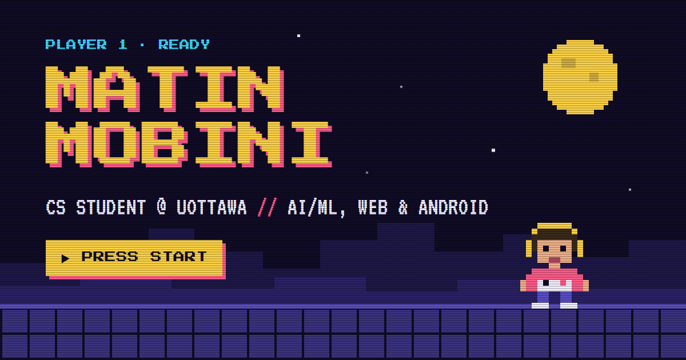

  

  

  

  
  
  

 

<table align="center">
  <tr>
    <td width="60%" valign="top">
      <h3>Hey, I'm Matin 👋</h3>
      

        I study Computer Science at the <b>University of Ottawa</b> with a concentration in <b>AI &amp; ML</b>.
        Right now I split my time between AI research at <b>Adaptron</b> and <b>Rally</b>, the app I'm co-founding.
      

      <table>
        <tr><td>🤖 <b>Now</b></td><td>AI Research Co-op at Adaptron</td></tr>
        <tr><td>🚩 <b>Building</b></td><td>Rally, as a Co-founder</td></tr>
        <tr><td>🧠 <b>Capstone</b></td><td>AI Therapy Assistant app, grounded in clinical research Complete RAG pipeline fed with smartwatch health data</td></tr>
        <tr><td>🏛️ <b>Before</b></td><td>Health Canada, Co-op (13 months) Software Developer, Data Science &amp; Analytics · 9 mos Junior Analyst, Data Science &amp; Analytics · 4 mos</td></tr>
      </table>
    </td>
    <td width="40%" align="center" valign="middle">
      
    </td>
  </tr>
</table>

<h3 align="center">🚩 What I'm Building</h3>

  

  
  
  

  <b>Rally</b> puts the pickup games, study sessions and jam nights around you on one map. 
  Find something nearby, show up, and keep the crew together. I'm one of its co-founders.

  

 

<h3 align="center">🕹️ My portfolio is a game</h3>

  

  A small neural network I trained with neuroevolution plays through my portfolio while you scroll. 
  Open its brain to see it think, watch a population learn live in the Training Lab, or take the controls yourself.

  
  

<h3 align="center">🛠️ Languages &amp; Tools</h3>

  

<h3 align="center">🎓 Coursework</h3>

Honours BSc in Computer Science (Co-op), University of Ottawa · GPA 3.9 / 4.0 · graduating April 2027

🏅 Admission Scholarship (2022) · Merit Scholarship (2023, 2024, 2025) · Montrusco Bolton Merit Scholarship (2026)

<table align="center">
  <tr>
    <td valign="top" width="50%">
      <table width="100%">
        <tr><th colspan="2" align="left">🤖 AI, ML &amp; Data</th></tr>
        <tr><td><code>SEG 4180</code> Applied Machine Learning</td><td align="right"><b>A+</b></td></tr>
        <tr><td><code>CSI 4142</code> Fundamentals of Data Science</td><td align="right"><b>A</b></td></tr>
        <tr><td><code>CSI 4107</code> Information Retrieval</td><td align="right"><b>A</b></td></tr>
        <tr><td><code>CSI 3105</code> Design &amp; Analysis of Algorithms</td><td align="right"><b>A-</b></td></tr>
      </table>
       
      <table width="100%">
        <tr><th colspan="2" align="left">📐 Math &amp; Statistics</th></tr>
        <tr><td><code>MAT 1322</code> Calculus II</td><td align="right"><b>A+</b></td></tr>
        <tr><td><code>MAT 1348</code> Discrete Math for Computing</td><td align="right"><b>A</b></td></tr>
        <tr><td><code>MAT 1341</code> Linear Algebra</td><td align="right"><b>A-</b></td></tr>
        <tr><td><code>MAT 1320</code> Calculus I</td><td align="right"><b>A-</b></td></tr>
        <tr><td><code>MAT 2377</code> Probability &amp; Statistics</td><td align="right"><b>B+</b></td></tr>
      </table>
    </td>
    <td valign="top" width="50%">
      <table width="100%">
        <tr><th colspan="2" align="left">💻 Core Computer Science</th></tr>
        <tr><td><code>CSI 2110</code> Data Structures &amp; Algorithms</td><td align="right"><b>A+</b></td></tr>
        <tr><td><code>CSI 2120</code> Programming Paradigms</td><td align="right"><b>A+</b></td></tr>
        <tr><td><code>CSI 3120</code> Programming Language Concepts</td><td align="right"><b>A+</b></td></tr>
        <tr><td><code>CSI 3104</code> Formal Languages</td><td align="right"><b>A+</b></td></tr>
        <tr><td><code>CSI 2372</code> Advanced Programming in C++</td><td align="right"><b>A+</b></td></tr>
        <tr><td><code>ITI 1121</code> Intro to Computing II (OOP)</td><td align="right"><b>A+</b></td></tr>
        <tr><td><code>CSI 2132</code> Databases I</td><td align="right"><b>A</b></td></tr>
        <tr><td><code>CEG 2136</code> Computer Architecture I</td><td align="right"><b>A</b></td></tr>
        <tr><td><code>CSI 2101</code> Discrete Structures</td><td align="right"><b>A</b></td></tr>
        <tr><td><code>SEG 2105</code> Software Engineering</td><td align="right"><b>A</b></td></tr>
        <tr><td><code>CSI 3140</code> Web Structures &amp; Standards</td><td align="right"><b>A</b></td></tr>
        <tr><td><code>CEG 3185</code> Data Communications &amp; Networking</td><td align="right"><b>A-</b></td></tr>
        <tr><td><code>CSI 3131</code> Operating Systems</td><td align="right"><b>B+</b></td></tr>
      </table>
    </td>
  </tr>
</table>

<h3 align="center">📊 Language Tracker</h3>

  

> [!NOTE]
> This account holds my personal and public projects. Most of my day-to-day development happens in private repositories on my work accounts, so the public history on this page only shows part of the picture.

  <picture>
    <source media="(prefers-color-scheme: dark)" srcset="https://raw.githubusercontent.com/MatinHMobini/MatinHMobini/output/github-snake-dark.svg" />
    <source media="(prefers-color-scheme: light)" srcset="https://raw.githubusercontent.com/MatinHMobini/MatinHMobini/output/github-snake.svg" />
    
  </picture>
   

<h3 align="center">🤝 Connect with me</h3>

  
  
  

